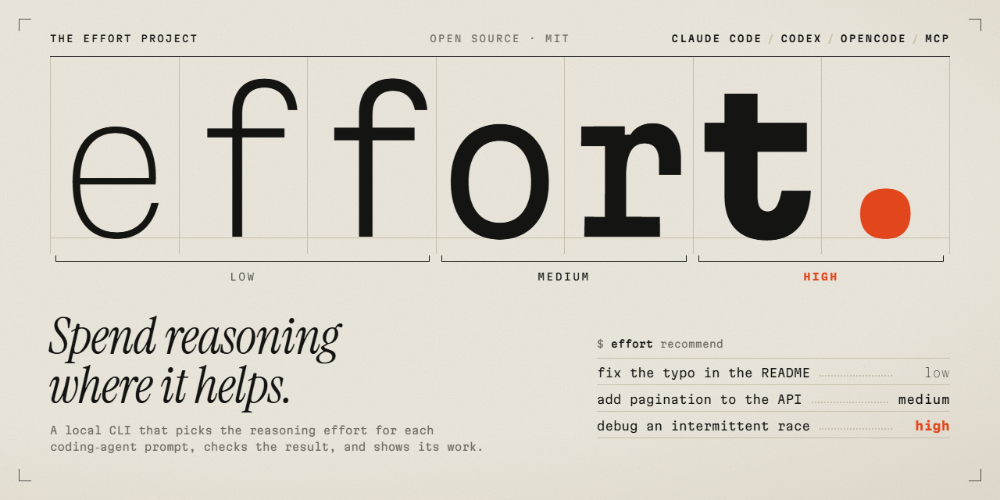

<p align="center">
  
</p>

# The Effort Project

[](LICENSE)
[](https://nodejs.org/)
[](package.json)

**Spend reasoning where it helps.** Effort picks a model and effort (low, medium or high) for coding-agent prompts, checks results with your tests, and explains each choice. It runs locally with no runtime dependencies, supporting Claude Code, Codex, Gemini, OpenCode and local MCP hosts.

> **Status: experimental (0.2).** Model and effort routing has functional live checks, but lower cost at equal quality is unproven. See [Limits](#limits).

## Why

Coding agents let you choose how hard the model thinks. Effort makes that choice before each prompt, using rules you can read in one file ([`src/policy.mjs`](src/policy.mjs)), and raises effort when your tests keep failing the same way.

It only uses each agent's real effort setting. It never edits your agent's settings files, never fakes effort by adding "think harder" to a prompt, and never interrupts a request that is already running.

## Set it up once

Effort plugs into the tool you already use. Choose a native plugin, an automatic session, or advisory MCP tools.

| You use | One-time setup | What you get in every session |
| --- | --- | --- |
| **Claude Code** | In Claude Code, run `/plugin marketplace add AntyLab/effort-project`, then `/plugin install effort-project@effort-project` | The plugin routes by itself through skills: Haiku/low or Fable/high in a fork, or high effort on the session model. Ordinary prompts stay unchanged. MCP tools and `/effort-project:explain` are included. [Details](docs/claude-code-plugin.md) |
| **OpenCode** | Run `effort config opencode` and save the output as `.opencode/plugins/effort.mjs` in your project | Effort switches the model's effort automatically before each prompt. [Details](docs/automatic.md#opencode-plugin) |
| **Codex CLI** | Start with `effort auto codex` | Model and effort routing in the normal terminal UI, using a built-in WebSocket server with no extra packages. [Details](docs/automatic.md#codex-terminal-router) |
| **Gemini** | Install and sign in to the Antigravity CLI (`agy`) | `effort run --provider gemini` for verified tasks; `effort auto gemini` for a text conversation. [Details](docs/automatic.md#gemini-through-antigravity) |
| **Claude desktop, or any app with local MCP** | Run `effort config claude` and merge the output into the app's MCP settings | The same MCP tools in that app. [Details](docs/desktop.md) |

`effort config codex` also prints advisory MCP setup for Codex. See [Automatic sessions](#automatic-sessions) for the session choices.

## Install

You need Node.js 22 or later. Effort has no npm dependencies and no install scripts.

```sh
npm install --global github:AntyLab/effort-project
effort doctor
```

`effort doctor` shows which agent CLIs Effort can start. The Claude Code plugin doesn't need this step, because Claude Code downloads it from GitHub, but it still needs Node.js 22 or later. To work on Effort itself, clone the repository and run `node bin/effort.mjs` wherever this page says `effort`.

To uninstall, run `npm uninstall --global effort-project`. Effort keeps run records in `~/.effort-project` (or in `EFFORT_DATA_DIR`); delete that folder to remove your history.

## Try it

```console
$ effort recommend "Fix the typo in the README" --provider codex
LOW · heuristic recommendation
Model: gpt-6-luna · tier: fast
The request appears short and mechanical; verify the result before accepting it.
A transparent heuristic, not a trained difficulty model or a measured quality guarantee.

$ effort recommend "Investigate an intermittent race condition in the job queue" --provider codex
HIGH · heuristic recommendation
Model: gpt-6-astra · tier: frontier
The request touches behavior where an incorrect change can be costly.
The request suggests investigation or changes with interacting parts.
A transparent heuristic, not a trained difficulty model or a measured quality guarantee.
```

## How Effort decides

Every recommendation lists its reasons. The full rules are in [`src/policy.mjs`](src/policy.mjs).

| What the request says | Starting effort |
| --- | --- |
| Risky work: security, login, passwords, tokens, billing, payments, migrations, destructive data changes, privacy or a race condition | high |
| Investigative work: investigate, debug, refactor, intermittent failures, crashes, leaks, hangs, performance, slowness or bisect | high |
| A short mechanical edit: a typo, spelling, rename, format, translation, summary, comment, docstring, lint, indentation, version bump, wording, whitespace or sort imports | low |
| Anything else | medium, the uncertain default |
| The request names five or more files in the workspace | one level higher, at most high |

Mechanical requests must be shorter than 350 characters. Risky or investigative words take precedence over mechanical words. Basic keyword coverage also includes Spanish, French, German, Portuguese and Italian; this is not a validated multilingual classifier.

The model tier is **fast** for short mechanical requests, **frontier** when a request is both high-stakes and investigative or tangled, and **daily** otherwise.

| Provider | fast | daily | frontier |
| --- | --- | --- | --- |
| Claude | haiku | sonnet | fable |
| Codex | gpt-6-luna | gpt-6.1-sol | gpt-6-astra |
| Gemini | gemini-4-hydrogen | gemini-4-argon | gemini-4-argon |

Pin a model with `--model MODEL_ID`. In `effort auto`, `--routing-config` can override the built-in choices with an effort-to-model table. Precedence is the pin, configured table, built-in tier, then current/default model. See [model routing](docs/automatic.md#model-routing).

Limits you set with `--effort`, `--min-effort` and `--max-effort` always win. How many languages a repository uses doesn't change the effort, because it describes the repository, not the request.

When Effort runs the agent itself and your tests fail:

- The first failure gets one retry at the same effort, with the test output attached.
- If the same tests fail again, the next attempt uses one level more, up to your ceiling.
- Anything that more reasoning can't fix stops the run: a missing dependency, an unreachable service, a permission or login problem, a timeout, or output Effort doesn't recognize.

## Run a task with verification

`effort run` starts your installed, signed-in Codex, Claude Code or Antigravity CLI, runs your test command after each attempt, and retries as described above. Start with a disposable project or a clean working tree.

```sh
effort run "Fix the failing sum test" --provider codex --cwd /path/to/project --allow-write -- node --test
```

- Everything after `--` is the test command. In Windows PowerShell, write the separator as `'--'`, or give each part with `--verify-arg node --verify-arg=--test`.
- Without a test command, the result is marked **unverified** and is never retried.
- By default a run gets 3 attempts and 10 minutes in total, and effort never goes above high. Add `--dry-run` to see the plan without starting anything.
- Your test command runs with your normal permissions, outside the agent's sandbox. Only use commands you trust.

All options, Windows notes and exit codes are in [managed runs](docs/managed-runs.md).

## Automatic sessions

To have effort change on its own before every prompt:

- **OpenCode:** the plugin above already does this.
- **Claude Code:** the plugin routes through skills in Claude's interface. `effort auto claude --cwd .` is an alternative text session that resumes the conversation with the chosen model and effort.
- **Codex:** `effort auto codex` routes the normal terminal through a local router using its built-in WebSocket server. No extra package is needed; the terminal UI connects and starts through it; typing a routed prompt there by hand remains a check.
- **Gemini:** `effort auto gemini --cwd .` resumes an Antigravity conversation in Effort's text interface.

See [automatic routing](docs/automatic.md).

## Dashboard (optional)

`effort dashboard` serves a local, read-only page with run history and a recommendation box; open the printed URL. It cannot start runs. `effort history` shows the same list in the terminal.

The page is served on `127.0.0.1`, and the printed URL contains a one-time access token, so keep that URL private.

## Privacy and safety

- No cloud service, telemetry, update checks or outside classifier. Recommendations run on your machine.
- Effort doesn't store prompts, code, responses or test output. Run records hold only Effort's decisions, coarse repository facts, timings and outcomes.
- Your agent CLI still sends prompts to its provider and keeps its own transcripts, under that provider's policies.
- See [SECURITY.md](SECURITY.md) for the remaining boundaries.

## Limits

- **Rules, not a trained model.** They are keyword and length rules with basic coverage for English and five other languages, low confidence, and no measure of how hard a task really is.
- **Savings aren't proven yet.** Effort hasn't shown lower cost at equal quality. See [what has been tested](docs/validation.md).
- **Claude Code routing depends on Claude following the hook.** Forks lose earlier context unless Claude passes it along; the main model still reads the prompt and relays the answer.
- **Codex desktop and Claude desktop MCP remain advisory.** MCP tools cannot change the host conversation's model or effort.
- **No spending cap.** Frontier models cost more. Time, attempt and effort limits do not guarantee a final bill.
- **Gemini needs Antigravity CLI.** File permissions last for the session only; shell commands are never allowed. Token usage is reported, cost is not.

## Contributing

```sh
npm test
npm run check
npm run smoke:package
```

The tests use fake agent processes and never spend model credits. Start with [CONTRIBUTING.md](CONTRIBUTING.md), the [architecture notes](docs/architecture.md), the [adapter contract](docs/adapter-contract.md) and the [handoff notes](docs/HANDOFF.md). Checks against real agents and evaluation work are especially welcome. Please don't add adapters that only print an effort label without setting a real provider parameter.

MIT licensed. An independent project, not affiliated with OpenAI, Anthropic or Google.
