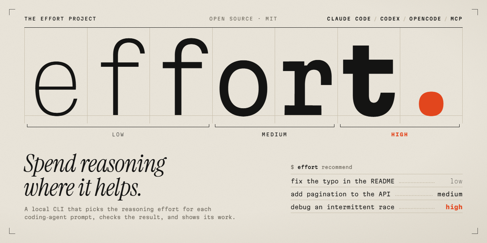

<p align="center">
  
</p>

# The Effort Project

[](LICENSE)
[](https://nodejs.org/)
[](package.json)

**Spend reasoning where it helps.** Effort picks a reasoning effort (low, medium or high) for each prompt you give a coding agent, checks the result with your own tests, and tells you why it chose that level. It runs entirely on your machine, has no runtime dependencies, and works with Claude Code, Codex, OpenCode and any app that supports local MCP servers.

> **Status: experimental (0.1).** Effort's decisions come from transparent rules, not a trained model, and it has not yet shown lower cost at equal quality. See [Limits](#limits).

## Why

Coding agents let you choose how hard the model thinks, but almost nobody changes that setting from one prompt to the next. High effort on a typo wastes time and tokens. Low effort on a race condition wastes an afternoon. Effort makes the call before each prompt, using rules you can read in one file ([`src/policy.mjs`](src/policy.mjs)), and raises effort only when your tests keep failing the same way.

It only uses each agent's real effort setting. It never edits your agent's settings files, never fakes effort by adding "think harder" to a prompt, and never interrupts a request that is already running.

## Set it up once

Effort plugs into the tool you already use. After a one-time setup, your agent starts Effort by itself in every session, so there is no terminal or web page to keep open.

| You use | One-time setup | What you get in every session |
| --- | --- | --- |
| **Claude Code** | In Claude Code, run `/plugin marketplace add AntyLab/effort-project`, then `/plugin install effort-project@effort-project` | A one-line suggestion before a prompt when a rule fires, such as *Effort suggests high for this prompt*. You apply it with `/effort high`. You also get Effort's MCP tools and the `/effort-project:explain` command. [Details](docs/claude-code-plugin.md) |
| **OpenCode** | Run `effort config opencode` and save the output as `.opencode/plugins/effort.mjs` in your project | Effort switches the model's effort automatically before each prompt. [Details](docs/automatic.md#opencode-plugin) |
| **Codex CLI** | Run `effort config codex` and add the output to `~/.codex/config.toml` | Effort's MCP tools: ask Codex which effort a task needs, then set it with Codex's own selector. [Details](docs/desktop.md) |
| **Claude desktop, or any app with local MCP** | Run `effort config claude` and merge the output into the app's MCP settings | The same MCP tools in that app. [Details](docs/desktop.md) |

Claude Code and Codex don't let a plugin change effort on its own, so in those tools Effort suggests and you decide. For automatic switching there, see [Automatic sessions](#automatic-sessions).

## Install

You need Node.js 22 or later. Effort has no npm dependencies and no install scripts.

```sh
npm install --global github:AntyLab/effort-project
effort doctor
```

`effort doctor` shows which agent CLIs Effort can start. The Claude Code plugin doesn't need this step, because Claude Code downloads it from GitHub, but it still needs Node.js 22 or later. To work on Effort itself, clone the repository and run `node bin/effort.mjs` wherever this page says `effort`.

To uninstall, run `npm uninstall --global effort-project`. Effort keeps run records in `~/.effort-project` (or in `EFFORT_DATA_DIR`); delete that folder to remove your history.

## Try it

```console
$ effort recommend "Fix the typo in the README"
LOW · heuristic recommendation
The request appears short and mechanical; verify the result before accepting it.
A transparent heuristic, not a trained difficulty model or a measured quality guarantee.

$ effort recommend "Investigate an intermittent race condition in the job queue"
HIGH · heuristic recommendation
The request touches behavior where an incorrect change can be costly.
The request suggests investigation or changes with interacting parts.
A transparent heuristic, not a trained difficulty model or a measured quality guarantee.
```

## How Effort decides

Every recommendation lists its reasons. The full rules are in [`src/policy.mjs`](src/policy.mjs).

| What the request says | Starting effort |
| --- | --- |
| Risky or investigative work, for example security, authentication, payments, migrations, data loss or a race condition, or words like *investigate*, *debug*, *refactor*, *intermittent* or *root cause* | high |
| A short mechanical edit: a typo, spelling, rename, format, translation or summary | low |
| Anything else | medium, the uncertain default |
| The request names five or more files in the workspace | one level higher, at most high |

Limits you set with `--effort`, `--min-effort` and `--max-effort` always win. How many languages a repository uses doesn't change the effort, because it describes the repository, not the request.

When Effort runs the agent itself and your tests fail:

- The first failure gets one retry at the same effort, with the test output attached.
- If the same tests fail again, the next attempt uses one level more, up to your ceiling.
- Anything that more reasoning can't fix stops the run: a missing dependency, an unreachable service, a permission or login problem, a timeout, or output Effort doesn't recognize.

## Run a task with verification

`effort run` starts your installed, signed-in Codex or Claude Code CLI, runs your test command after each attempt, and retries as described above. Start with a disposable project or a clean working tree.

```sh
effort run "Fix the failing sum test" --provider codex --cwd /path/to/project --allow-write -- node --test
```

- Everything after `--` is the test command. In Windows PowerShell, write the separator as `'--'`, or give each part with `--verify-arg node --verify-arg=--test`.
- Without a test command, the result is marked **unverified** and is never retried.
- By default a run gets 3 attempts and 10 minutes in total, and effort never goes above high. Add `--dry-run` to see the plan without starting anything.
- Your test command runs with your normal permissions, outside the agent's sandbox. Only use commands you trust.

All options, Windows notes and exit codes are in [managed runs](docs/managed-runs.md).

## Automatic sessions

To have effort change on its own before every prompt:

- **OpenCode:** the plugin above already does this.
- **Claude Code:** `effort auto claude --cwd .` runs Effort's own text session. It resumes your Claude Code conversation with the chosen effort for each prompt, but you give up Claude Code's own interface while you use it.
- **Codex:** `effort auto codex` routes the normal Codex terminal through a local router. It's an experimental prototype that needs the `ws` package, which isn't included yet.

See [automatic routing](docs/automatic.md).

## Dashboard (optional)

`effort dashboard` serves a local, read-only page with your run history and a box for trying recommendations; open the URL it prints. Nothing else depends on the dashboard and it can't start runs, so leave it closed unless you want to browse past runs. `effort history` shows the same list in the terminal.

The page is served on `127.0.0.1`, and the printed URL contains a one-time access token, so keep that URL private.

## Privacy and safety

- No cloud service, telemetry, update checks or outside classifier. Recommendations run on your machine.
- Effort doesn't store prompts, code, responses or test output. Run records hold only Effort's decisions, coarse repository facts, timings and outcomes.
- Your agent CLI still sends prompts to its provider and keeps its own transcripts, under that provider's policies.
- See [SECURITY.md](SECURITY.md) for the remaining boundaries.

## Limits

- **Rules, not a trained model.** They are English-oriented keyword and length rules with low confidence, and they don't measure how hard a task really is.
- **Savings aren't proven yet.** Effort hasn't shown lower cost at equal quality. See [what has been tested](docs/validation.md).
- **Suggestions only in Claude Code, Codex and desktop apps.** Their plugins and MCP tools can't change effort. Only OpenCode and the `effort auto` sessions switch it automatically.
- **No spending cap.** Time, attempt and effort limits bound a run, but don't guarantee your final bill.

## Contributing

```sh
npm test
npm run check
npm run smoke:package
```

The tests use fake agent processes and never spend model credits. Start with [CONTRIBUTING.md](CONTRIBUTING.md), the [architecture notes](docs/architecture.md), the [adapter contract](docs/adapter-contract.md) and the [handoff notes](docs/HANDOFF.md). Checks against real agents and evaluation work are especially welcome. Please don't add adapters that only print an effort label without setting a real provider parameter.

MIT licensed. An independent project, not affiliated with OpenAI or Anthropic.
